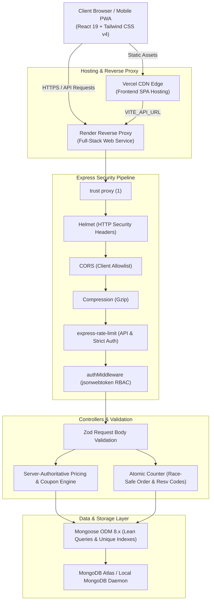

# VELORA — Culinary Excellence & Restaurant Operations Platform

> **Modern dining. Crafted to remember.**  
> VELORA is a production-ready, full-stack luxury restaurant ordering, table reservation, and executive operations management platform. Built with React 19, TypeScript, Vite, Tailwind CSS v4, Express, and MongoDB/Mongoose, it combines an atmospheric guest-facing dining journey with a real-time administrative operations console where every price calculation, coupon redemption, reservation conflict check, and kitchen lifecycle transition is computed server-authoritatively.

---

## Live Demos & Links

- **Full-Stack Application (Render)**: [https://velora-restaurant-platform.onrender.com](https://velora-restaurant-platform.onrender.com) *(Demo placeholder)*
- **Frontend SPA (Vercel)**: [https://velora-restaurant-frontend.vercel.app](https://velora-restaurant-frontend.vercel.app) *(Demo placeholder)*
- **GitHub Repository**: [https://github.com/your-username/velora](https://github.com/your-username/velora) *(Demo placeholder)*

---

## Visual Previews

<!-- slide -->
```
+----------------------------------------------------------------------------------------------------+
|  [VELORA LOGO]    Menu   Reservations   Offers   About   [⌘K Search]    [Cart (3)]   [Profile / Staff] |
|                                                                                                    |
|    "WHERE SAVORY ARTISTRY MEETS ATMOSPHERIC NOCTURNE"                                              |
|    Wood-Fired Truffle Sourdough • A5 Miyazaki Wagyu • Artisanal Sommelier Zero-Proof Elixirs       |
|                                                                                                    |
|    [ Explore Tasting Menu ]              [ Reserve a Private Table ]                                |
+----------------------------------------------------------------------------------------------------+
```
*Screenshots placeholder: Hero Landing, Interactive Dish Customizer, Live Kitchen Order Tracker, and Executive Admin Analytics Console.*

---

## Features

### Guest & Customer Experience
- **Interactive Culinary Catalog & Search**: Filter dishes by category (Starters, Mains, Pizza, Burgers, Pasta, Indian, Chinese, Desserts, Drinks), dietary preference (Vegetarian, Non-Veg), spice intensity, or search globally using keyboard shortcut `Cmd/Ctrl + K`.
- **Authoritative Dish Customizer**: Real-time customization across portion sizes (`Regular`, `Large`, `Family`), chef add-ons (Périgord Black Truffle, Pugliese Burrata, Oscietra Caviar), spicy levels, and bespoke prep instructions.
- **Server-Verified Cart & Checkout**: Persistent cart with "Save for Later", server-calculated subtotals, automated tax computations, delivery fee tiers with free delivery thresholds, and multi-tier coupon code redemptions.
- **Live 6-Stage Order Tracker**: Real-time order progress timeline (`Placed` → `Confirmed` → `Preparing` → `Ready` → `Out for Delivery` → `Delivered`) with audit history timestamps.
- **Conflict-Checked Table Reservations**: Live slot availability lookup across dining areas (`Main Dining Room`, `Velvet Chef Counter`, `Solarium Garden Terrace`, `Private Vault`), party size limits (1–20 guests), and atomic double-booking prevention.
- **Customer CRM & Concierge**: Profile management, multi-address book, favorite dishes wishlist, past order history, and dish reviews.

### Executive Operations & Administration (`/admin`)
- **Direct Database Analytics**: Real-time business KPIs computed via Mongoose aggregations (Total Gross Revenue, Daily Revenue, 7-Day Order Volume, Order Status Distribution, Top Dishes by Volume/Revenue, Category Revenue Share, Peak Service Hours, and Seating Area Demand).
- **Kitchen & Order Management**: Filter orders by status, inspect itemized receipts, advance kitchen/delivery stages, and process simulated refunds on cancelled paid orders.
- **Table Reservation Operations**: Confirm, seat, complete, or decline bookings; track table turnover and guest requirements.
- **Culinary Catalog CMS**: Create, update, toggle availability, and archive dishes and culinary categories.
- **Promotions & Offers CMS**: Manage percentage and fixed discount coupons, usage limits, minimum order thresholds, and banner marketing campaigns.
- **Staff Roster & Restaurant Settings**: Configure staff shifts, roles, service hours, tax rates, delivery fee rules, and minimum order values.

---

## Tech Stack

| Layer | Technologies |
| :--- | :--- |
| **Frontend** | React 19, TypeScript 5.8, Vite 6, Tailwind CSS v4, Lucide React, React Router v7 |
| **Backend** | Node.js (>=20), Express 4.21, TypeScript (`tsx` / `tsc`), Helmet, CORS, Compression |
| **Database & ODM** | MongoDB 8.x, Mongoose ODM 8.12 (Indexes, Lean queries, Schema validation) |
| **Security & Auth** | `jsonwebtoken`, `bcryptjs`, `express-rate-limit`, `zod`, Node `crypto` (`randomUUID`) |
| **Testing** | Vitest 3.x, Supertest (Auth, RBAC, Ownership, Cancellations, Coupons, Price Calculation) |
| **DevOps & CI/CD** | GitHub Actions, Render Blueprint (`render.yaml`), Vercel Configuration (`vercel.json`) |

---

## Architecture



---

## Local Setup & Development

### Prerequisites
- **Node.js**: `v20.0.0` or higher
- **npm**: `v10.0.0` or higher
- **MongoDB**: Local MongoDB instance running on `mongodb://127.0.0.1:27017` OR a MongoDB Atlas cluster URI. *(If running in dev without MongoDB, `mongodb-memory-server` provides an ephemeral fallback).*

### 1. Clone & Install
```bash
git clone https://github.com/your-username/velora.git
cd velora
npm install
```

### 2. Configure Environment Variables
Copy `.env.example` to `.env`:
```bash
cp .env.example .env
```
Ensure `JWT_SECRET` and `MONGODB_URI` are set (see [Environment Variables](#environment-variables) below).

### 3. Seed Database
Populate the database with initial menu items, categories, demo users, coupons, and restaurant settings:
```bash
npm run seed
```
*(The seed script is idempotent and safe to re-run).*

### 4. Start Development Server
Starts the full-stack development server with Vite hot module replacement (HMR) and Express API on port `3000`:
```bash
npm run dev
```
Open [http://localhost:3000](http://localhost:3000) in your browser.

---

## Available Scripts

| Command | Description |
| :--- | :--- |
| `npm run dev` | Starts full-stack development server (Express + Vite HMR on port 3000) |
| `npm run build` | Builds Vite frontend into `dist/` and compiles server into `dist-server/` |
| `npm start` | Runs compiled production server (`node dist-server/server.js`) |
| `npm run seed` | Idempotently seeds MongoDB collections with initial catalog & demo accounts |
| `npm test` | Runs complete automated test suite via Vitest |
| `npm run typecheck` | Executes TypeScript type checking (`tsc --noEmit`) without compilation |
| `npm run lint` | Runs ESLint flat configuration across `src` and `backend` |

---

## Environment Variables

| Variable | Required in Prod | Default / Example | Purpose |
| :--- | :---: | :--- | :--- |
| `NODE_ENV` | Yes | `development` / `production` | Runtime mode: enables production optimizations and strict checks |
| `PORT` | No | `3000` | Port for the Express server |
| `MONGODB_URI` | Yes | `mongodb://127.0.0.1:27017/velora` | MongoDB connection string (Local or MongoDB Atlas) |
| `JWT_SECRET` | Yes | `min_32_characters_random_secret` | Cryptographic secret for signing and verifying JWTs |
| `CLIENT_URL` | Yes | `http://localhost:3000` | Explicit origin allowlist for CORS (comma-separated for multiples) |
| `VITE_API_URL` | No | `""` (empty for same origin) | API base URL for decoupled frontend deploys (e.g. on Vercel) |
| `VITE_DEMO_MODE` | No | `true` | When `true`, enables the "Demo accounts" quick-fill modal on login |
| `EMAIL_HOST` | No | `sandbox.smtp.mailtrap.io` | SMTP server host for simulated password reset notifications |
| `EMAIL_PORT` | No | `2525` | SMTP port |
| `EMAIL_USER` | No | `your_mailtrap_user` | SMTP username |
| `EMAIL_PASSWORD` | No | `your_mailtrap_password` | SMTP password |
| `PAYMENT_SECRET` | No | `sk_test_simulated_secret` | Sandbox payment secret token (simulated test mode) |

---

## Demo Accounts & Test Credentials

When `VITE_DEMO_MODE=true` is set, a **Demo accounts** button is available on the login page to populate credentials with one click:

| Role | Email | Password | Permissions & Capabilities |
| :--- | :--- | :--- | :--- |
| **Admin** | `admin@velora.com` | `admin123` | Full access to `/admin` dashboard, analytics, menu CMS, staff, coupons & settings |
| **Staff** | `staff@velora.com` | `staff123` | Kitchen order stage updates, table reservations management, menu availability |
| **Customer** | `elena@example.com` | `customer123` | Guest checkout, past order history (`#10482`), reservations, address book & wishlist |

### Active Test Coupons
- `WELCOME10`: 10% off orders over $30 (maximum savings $25)
- `FIRSTORDER`: Flat $15 off tasting orders over $50
- `SAVE20`: 20% off orders over $75 (maximum savings $35)
- `WEEKEND25`: 25% off weekend feasts over $100 (maximum savings $45)

---

## Deployment Guide

### 1. MongoDB Atlas Setup
1. Create a free M0 cluster on [MongoDB Atlas](https://www.mongodb.com/cloud/atlas).
2. Under **Database Access**, create a user with `Read and write to any database` privileges.
3. Under **Network Access**, add IP `0.0.0.0/0` (allow access from anywhere) to accept connections from Render/Vercel.
4. Copy the connection string: `mongodb+srv://<username>:<password>@cluster0.xxxxx.mongodb.net/velora?retryWrites=true&w=majority`.

### 2. Render Deployment (Full-Stack Web Service)
This repository includes a native `render.yaml` blueprint.
1. Connect your GitHub repository to [Render](https://render.com).
2. Create a new **Web Service** (or use the Blueprint from `render.yaml`):
   - **Environment**: `Node`
   - **Build Command**: `npm install && npm run build`
   - **Start Command**: `npm start`
   - **Health Check Path**: `/api/health`
3. Configure Environment Variables in the Render dashboard:
   - `NODE_ENV`: `production`
   - `MONGODB_URI`: `<Your MongoDB Atlas Connection String>`
   - `JWT_SECRET`: `<Secure random string, minimum 32 characters>`
   - `CLIENT_URL`: `https://your-service-name.onrender.com`
4. Run `npm run seed` once from the Render Shell or your local machine with `MONGODB_URI` set to initialize collections.

### 3. Vercel Deployment (Frontend-Only)
If deploying the frontend independently to Vercel:
1. Import your GitHub repository into [Vercel](https://vercel.com).
2. Configure project settings:
   - **Framework Preset**: `Vite`
   - **Build Command**: `npm run build`
   - **Output Directory**: `dist`
3. Add Environment Variable:
   - `VITE_API_URL`: `https://your-render-backend.onrender.com` (points to your Render backend)
4. Deploy. The included `vercel.json` ensures all SPA routes rewrite to `index.html`.

---

## Security Architecture & Best Practices

1. **Cryptographic Authentication**:
   - Industry-standard `jsonwebtoken` with 72-hour token lifespan and `iss: 'velora-api'`.
   - Passwords hashed using `bcryptjs` with salt factor 10.
   - Password reset tokens use 256-bit cryptographically secure pseudorandom raw tokens (`crypto.randomBytes`), stored as SHA-256 hashes with 15-minute expirations.
2. **Strict CORS Policy**:
   - `cors` package configured with an explicit allowlist sourced from `CLIENT_URL`.
   - Production disallows wildcard `*` origins and disallows untrusted referrers.
3. **Hardened HTTP Headers & Reverse Proxy**:
   - `helmet` protection against XSS, clickjacking, and MIME sniffing.
   - `compression` gzip middleware for high-performance payload delivery.
   - `app.set('trust proxy', 1)` enabled for correct IP resolution behind reverse proxies (Render, AWS ALB, Cloudflare).
4. **Multi-Tiered Rate Limiting**:
   - General API limiter: 500 requests per 15-minute window per IP.
   - Auth endpoints limiter (`/api/auth/login`, `/api/auth/register`, `/api/auth/forgot-password`): 20 requests per 15-minute window to eliminate brute-force risk.
5. **Schema-Enforced Input Validation**:
   - Every incoming request body is validated against rigorous Zod schemas before reaching business logic.
   - Client-supplied prices, discount values, and roles are discarded; the server computes all values authoritatively.
6. **Race-Safe Atomic Counters & Conflict Prevention**:
   - Order numbers (`VLR-XXXXX`) and reservation codes (`VLR-RXXXX`) utilize MongoDB atomic `$inc` counters (`CounterModel`) with retry loops to guarantee uniqueness without race conditions.
   - Reservation bookings enforce a strict capacity limit of 6 tables per time slot to prevent double-booking.

---

## Known Limitations & Simulated Features

To maintain transparency as a portfolio project:
- **Simulated Payment Gateway**: Transactions placed via Card or UPI use simulated sandbox processing. Successful checkouts create valid database transaction records and itemized receipts, but do not interact with live banking networks.
- **Simulated Email Dispatch**: Password reset emails and order confirmation notifications are routed to a simulated SMTP dispatcher (e.g. Mailtrap or console logging) unless valid custom SMTP credentials are provided in `.env`.

---

## License

This project is open-source and licensed under the [MIT License](LICENSE).
